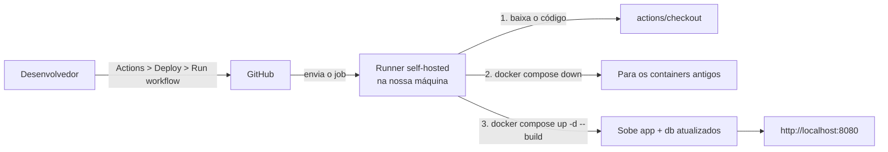

# Pokedex CRUD — PHP + MySQL + Docker

## 1. Descrição do projeto

Aplicação web CRUD (Create, Read, Update, Delete) desenvolvida em **PHP** com banco de
dados **MySQL**, totalmente orquestrada com **Docker Compose**.

A entidade escolhida foi **Pokémon**. Cada registro cadastrado no banco possui os campos:

- `id` — chave primária, auto incremento
- `nome` — nome do Pokémon
- `tipo` — tipo (ex.: elétrico, fogo, água...)
- `descricao` — anotação livre escrita pelo usuário sobre o Pokémon
- `data_cadastro` — data em que o registro foi criado (definida automaticamente pelo servidor)
- `imagem_url` — link do sprite oficial do Pokémon

O grande diferencial do projeto é que o cadastro **não é feito digitando os dados manualmente**:
o usuário busca o Pokémon pelo nome ou número (ex.: `pikachu` ou `25`) e a aplicação consome a
**[PokeAPI](https://pokeapi.co/)** (API pública e gratuita) diretamente do navegador, via
JavaScript `fetch`, para trazer nome, tipo e imagem oficiais. Isso garante que os dados
cadastrados na Pokedex sempre correspondam a um Pokémon real, existente na PokeAPI.

## 2. Pré-requisitos

- [Docker](https://www.docker.com/) instalado
- [Docker Compose](https://docs.docker.com/compose/) instalado (já vem junto com o Docker Desktop)
- Conexão com a internet (necessária para a busca na PokeAPI ao cadastrar um Pokémon)

Nenhuma outra dependência é necessária na máquina.

## 3. Passo a passo para executar o projeto

1. **Clone o repositório:**
   ```bash
   git clone <URL_DO_REPOSITORIO>
   cd php-mysql-docker-crud
   ```

2. **Suba os containers:**
   ```bash
   docker compose up -d
   ```
   Esse comando sobe dois containers: o da aplicação PHP (`pokedex_app`) e o do banco de
   dados MySQL (`pokedex_db`).

3. **Criação da tabela no banco:**
   A tabela `pokemons` **não precisa ser criada manualmente**. O arquivo `src/db.php` é
   incluído em todas as páginas da aplicação e, a cada requisição, executa um
   `CREATE TABLE IF NOT EXISTS`, criando a tabela automaticamente caso ela ainda não
   exista. Ou seja: assim que a aplicação PHP consegue se conectar ao MySQL pela primeira
   vez, a estrutura do banco já fica pronta para uso, sem precisar rodar nenhum script
   `.sql` à parte.

4. **Acesse a aplicação no navegador:**
   ```
   http://localhost:8080
   ```

5. **Para derrubar os containers:**
   ```bash
   docker compose down
   ```
   (os dados do banco continuam salvos no volume `db_data`, mesmo depois do `down`)

## 4. Explicação do `compose.yaml`

O arquivo já contém comentários linha a linha explicando cada diretiva. Em resumo:

### Serviço `app`
- Usa a imagem pronta `php:8.1-apache` (PHP + Apache já integrados).
- Mapeia a porta `8080` da máquina host para a porta `80` do container, permitindo acessar
  a aplicação em `http://localhost:8080`.
- Usa um **volume bind mount** (`./src:/var/www/html`) que sincroniza a pasta local `src/`
  com a raiz do servidor Apache dentro do container — qualquer alteração nos arquivos PHP
  locais é refletida imediatamente, sem precisar reconstruir a imagem.
- No `command`, instala a extensão `pdo_mysql` (necessária para o PHP conversar com o
  MySQL via PDO) antes de iniciar o Apache.
- Recebe as variáveis de ambiente `DB_HOST`, `DB_USER`, `DB_PASSWORD` e `DB_NAME`
  diretamente na seção `environment` do compose (sem uso de arquivo `.env`), que são lidas
  pelo `db.php` através de `getenv()` para montar a conexão PDO.
- Depende do serviço `db` (`depends_on`), garantindo que o banco suba antes da aplicação.

### Serviço `db`
- Usa a imagem oficial `mysql:8.0`.
- Recebe `MYSQL_ROOT_PASSWORD` e `MYSQL_DATABASE`, variáveis próprias da imagem do MySQL
  que definem a senha do usuário root e criam automaticamente o banco `pokedex` na
  primeira inicialização do container.
- Usa `restart: always`, reiniciando o container automaticamente em caso de falha.
- Usa um **volume nomeado** (`db_data:/var/lib/mysql`), garantindo que os dados do banco
  persistam mesmo se o container for removido e recriado.

### Rede
Os dois serviços são conectados à rede personalizada `pokedex-network` (driver `bridge`),
o que permite que o container `app` se conecte ao banco simplesmente usando o nome do
serviço (`db`) como host — é exatamente o valor usado na variável `DB_HOST`.

## 5. Deploy automatizado com GitHub Actions (self-hosted runner)

Além de rodar o projeto manualmente (seção 3), o repositório possui um **workflow de deploy**
no GitHub Actions que sobe a aplicação automaticamente em uma máquina própria, usando um
**runner self-hosted**.

### 5.1 O que é um runner self-hosted?

O *runner* é o programa que de fato **executa** os passos de um workflow. Por padrão, o
GitHub usa runners hospedados por ele (`ubuntu-latest`, por exemplo), que são máquinas
virtuais temporárias na nuvem. Já um **runner self-hosted** é uma máquina **nossa** (um PC,
notebook ou servidor) que fica conectada ao GitHub e executa os jobs no lugar das VMs dele.

Neste projeto isso é necessário porque o objetivo do deploy é subir os containers
(`pokedex_app` e `pokedex_db`) **na nossa própria máquina**, onde o Docker está instalado e
onde a aplicação fica acessível em `http://localhost:8080`. Um runner na nuvem rodaria o
deploy em uma VM que é descartada logo depois, sem nenhum efeito na nossa máquina.

### 5.2 Como o fluxo funciona



O runner fica **escutando** o GitHub (ele faz as requisições de saída, então não é preciso
abrir portas no roteador). Quando um workflow é disparado, o GitHub entrega o job ao runner,
que o executa localmente e devolve os logs para a aba *Actions*.

### 5.3 O workflow `.github/workflows/deploy.yml`

```yaml
name: Deploy

on:
  workflow_dispatch:

jobs:
  deploy:
    runs-on: self-hosted

    steps:
      - name: Checkout
        uses: actions/checkout@v4

      - name: Docker
        run: |
          echo "Iniciando o deploy..."
          docker compose down
          docker compose up -d --build
          echo "Deploy realizado com sucesso!"
```

Explicação de cada parte:

- **`on: workflow_dispatch`** — o workflow é disparado **manualmente**, por um botão na aba
  *Actions* do GitHub. Ele não roda sozinho a cada push.
- **`runs-on: self-hosted`** — diz ao GitHub para enviar o job a um runner self-hosted, e não
  a uma VM hospedada por ele.
- **`actions/checkout@v4`** — baixa o código do repositório para a pasta de trabalho do
  runner (`_work`), garantindo que o deploy use a versão mais recente do código.
- **`docker compose down`** — para e remove os containers da versão anterior. O volume
  `db_data` **não é removido** (não usamos a flag `-v`), então os dados do banco continuam
  salvos.
- **`docker compose up -d --build`** — sobe os containers novamente em segundo plano (`-d`),
  reconstruindo o que for necessário (`--build`).

### 5.4 Como configurar o runner na máquina

**Pré-requisitos na máquina que será o runner:**

- Docker e Docker Compose instalados e funcionando
- Git instalado
- O usuário que executa o runner precisa ter permissão para usar o Docker
  (no Linux: `sudo usermod -aG docker $USER`, depois reiniciar a sessão)
- Conexão com a internet (para falar com o GitHub)

**Passo a passo:**

1. No repositório do GitHub, vá em **Settings → Actions → Runners → New self-hosted runner**.
2. Escolha o sistema operacional da máquina (Linux, Windows ou macOS). O GitHub mostra os
   comandos já preenchidos com a URL do repositório e um **token de registro temporário**.
3. Baixe e extraia o runner, seguindo os comandos exibidos na própria página. No Linux,
   por exemplo:
   ```bash
   mkdir actions-runner && cd actions-runner
   curl -o actions-runner-linux-x64.tar.gz -L <URL_EXIBIDA_PELO_GITHUB>
   tar xzf actions-runner-linux-x64.tar.gz
   ```
4. Registre o runner no repositório:
   ```bash
   ./config.sh --url https://github.com/<USUARIO>/<REPOSITORIO> --token <TOKEN_EXIBIDO>
   ```
   Durante a configuração, o nome e as labels podem ser mantidos no padrão. A label
   `self-hosted` é adicionada automaticamente, e é ela que o `runs-on` do workflow usa.
5. Inicie o runner:
   ```bash
   ./run.sh
   ```
   No Windows, os equivalentes são `config.cmd` e `run.cmd`.
6. Volte em **Settings → Actions → Runners**: o runner deve aparecer com o status
   **Idle** (online e aguardando jobs).

> **Dica:** com `./run.sh` o runner só funciona enquanto o terminal estiver aberto. Para
> deixá-lo rodando em segundo plano e iniciando junto com a máquina, instale-o como serviço
> (Linux: `sudo ./svc.sh install && sudo ./svc.sh start`; Windows: o `config.cmd` oferece
> instalar como serviço durante a configuração).

> **Atenção:** o token de registro expira em poucos minutos e **não deve ser commitado** nem
> compartilhado. Se precisar registrar outro runner, gere um novo token na mesma tela.

### 5.5 Como executar o deploy

1. Confirme que o runner está **online** (*Idle*) em Settings → Actions → Runners.
2. Vá na aba **Actions** do repositório e selecione o workflow **Deploy**.
3. Clique em **Run workflow** e confirme.
4. Acompanhe a execução pelos logs. Ao terminar com sucesso, a aplicação estará atualizada em
   `http://localhost:8080` na máquina do runner.

Se o runner estiver desligado ou offline, o job fica na fila (*Queued*) até ele voltar.

### 5.6 Observações importantes

- **A aplicação roda na máquina do runner.** O bind mount `./src:/var/www/html` aponta para a
  pasta de trabalho do runner (`_work/<repo>/<repo>/src`), que é atualizada pelo `checkout` a
  cada execução.
- **Nomes de container fixos.** Como o `compose.yaml` usa `container_name`, só pode existir
  uma instância do projeto por máquina. Por isso o `docker compose down` vem antes do `up`.
- **Segurança.** Um runner self-hosted executa código do repositório diretamente na sua
  máquina. Use-o apenas em repositórios confiáveis e evite habilitá-lo para pull requests
  vindos de forks de desconhecidos. Aqui o risco é reduzido porque o workflow só é disparado
  manualmente.

### 5.7 Problemas comuns

| Problema | Possível causa / solução |
|---|---|
| Job fica em *Queued* e não começa | O runner está offline. Inicie o `./run.sh` ou o serviço. |
| `docker: command not found` | O Docker não está instalado ou não está no `PATH` do usuário do runner. |
| `permission denied` ao acessar o Docker | O usuário do runner não está no grupo `docker` (Linux). |
| `docker compose` não é reconhecido | Versão antiga do Docker. Instale o plugin Compose v2. |
| `port is already allocated` (8080) | Outro processo ou container já usa a porta 8080 na máquina. |
| Erro de registro ao rodar `config.sh` | O token expirou. Gere um novo em *New self-hosted runner*. |

## 6. Autores

- Joao Vitor Paiva Borges
- Nikolas Lodi Monteiro
